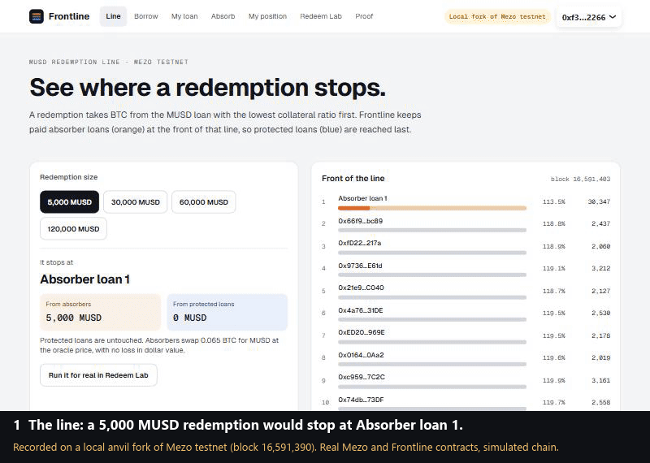

# Frontline

A redemption market for MUSD on Mezo. Borrowers stop being redeemed by paying BTC holders who are glad to be redeemed first.

**Status: in progress for the Mezo Buildathon, Wave 2 (deadline 13 Nov 2026).** This README grows with the build; nothing below is claimed as working until it is linked to a transaction or a test.

## The problem, in Mezo's own numbers (mainnet, read 5 Nov 2026)

- Redemptions hit MUSD loans **1,310** times; liquidations **28** times.
- **1,176** redemptions took **78.9 BTC** from **189** borrowers. **3** loans remain open.
- MUSD trades at **$0.990**, so buying it and redeeming at $1 minus a 0.75% fee is a standing arbitrage against the weakest loan.

Method and sources: [docs/idea-research.md](docs/idea-research.md).

## How Frontline works

MUSD redeems loans in order of collateral ratio, lowest first, and nobody can skip ahead (`TroveManager.redeemCollateral`). Frontline puts a paid layer of willing **absorber** loans at the front of that line. **Protected** borrowers stay on Mezo's official troves, sit behind the absorbers, and pay a premium that streams to them. Redemptions keep defending the peg; Frontline changes who pays for them. Liquity v2 fixed the same problem with paid redemption ordering; MUSD cannot change its core, so we build that market on top.

Plan: [docs/plan.md](docs/plan.md). Architecture: [docs/architecture.md](docs/architecture.md). Decisions: [docs/decisions/](docs/decisions/).

## What is proven so far

36 contract tests pass, including 30 end-to-end fork tests against the real MUSD contracts on Mezo testnet (`contracts/test/fork/`) and the spikes in [docs/spikes.md](docs/spikes.md):
- A contract can own and manage a trove (open with hints: 525,675 gas).
- A real `redeemCollateral` hits the absorber loan and leaves the protected loan untouched.
- A full hit closes the absorber loan and its surplus BTC is claimable.
- After a 3% BTC drop, repaying from the vault's held MUSD restores the absorber from 111% to 125%.
- A 6 Nov self-review found one High and two Medium issues (surplus BTC missing from NAV, just-in-time premium capture, premium rate pumping); all are fixed with fork tests. Details: [docs/security.md](docs/security.md).

## The hero path, recorded on a local fork



This clip is **not** live testnet. It was recorded on 5 Nov against the first deployment, before the 6 Nov security fixes, which do not change this path. It runs the production web app, built in a fork mode, against an anvil fork of Mezo testnet (block 16,591,390) that holds the real MUSD and Frontline contracts. Every step is a transaction sent from the app's own wallet flow: open a protected loan (0.2 BTC, 6,000 MUSD), redeem 5,000 MUSD in Redeem Lab, see Absorber loan 1 drop from 30,347 to 25,347 MUSD while the protected loan keeps its 0.2 BTC and 6,206 MUSD of debt. MP4: [frontline-fork-hero.mp4](design/demo/fork-clip/frontline-fork-hero.mp4).

Why a fork: on 5 Nov testnet BTC fell about 4.5%, and third-party loans now sit at 110.5 to 112% ratio, under our 112% band. A live redemption would have to close other teams' loans first, which Redeem Lab refuses to do. The fork setup (`web/scripts/fork-setup.ts`) moves those loans back by adding collateral on the fork only, at testnet's live BTC price, then deposits and deploys one absorber loan. The live testnet run follows when the front of the line clears.

Reproduce (Git Bash, from `web/`):

```bash
anvil --fork-url https://rpc.test.mezo.org --fork-block-number 16610000 --chain-id 31611 --port 8546
pnpm fork:setup
NEXT_PUBLIC_ADAPTER=chain NEXT_PUBLIC_NETWORK=testnet NEXT_PUBLIC_RPC_URL=http://127.0.0.1:8546 NEXT_PUBLIC_FORK_DEMO=1 pnpm build && pnpm start -p 3125
```

Fork mode refuses to run outside local development (`web/src/lib/env.ts`), labels every page "Local fork of Mezo testnet" and does not link fork transactions to the public explorer.

## Deployed on Mezo testnet (chain 31611)

| Contract | Address | Source |
|---|---|---|
| AbsorberVault | [0x0CD1…A265](https://explorer.test.mezo.org/address/0x0CD16Bb4d327e2bA0947deE279073cEc2E0DA265) | verified |
| ProtectedLoanFactory | [0xD8f8…957e](https://explorer.test.mezo.org/address/0xD8f888161FAcB6529e9389B2b1b9E3Df2636957e) | verified |
| FrontlineLens | [0x943d…B874](https://explorer.test.mezo.org/address/0x943d4252c759249D24D375E855B0a3caf13DB874) | verified |
| ProtectedLoan (template, created by the factory) | [0x73E6…E251](https://explorer.test.mezo.org/address/0x73E6b5965779e1823c607458F9d79ac8Cf8eE251) | bytecode matches `contracts/out` exactly |
| AbsorberTrove 0 and 1 (created by the vault) | [0x917e…C4Ef](https://explorer.test.mezo.org/address/0x917ee2bdD16621A8aD2797D836B0d2544e6dC4Ef), [0x1d17…9e15](https://explorer.test.mezo.org/address/0x1d174559Be0a9E968bfA17d088d21930dEA59e15) | created by the verified vault |

Redeployed 6 Nov at block 16,608,874 with the self-review fixes; the first deployment (5 Nov, block 16,591,000) is retired and never held deposits. Built on Mezo's MUSD contracts: TroveManager `0xE47c…6bb0`, SortedTroves `0x722E…68fA`, BorrowerOperations `0xCdF7…bEE5`, PriceFeed `0x86bC…9366`. Band 112 to 115%. Deploy record: `contracts/deployments/testnet.json` and `contracts/broadcast/`.

## Repository

| Path | What |
|---|---|
| `contracts/` | Foundry project, Solidity 0.8.28, London EVM |
| `web/` | Next.js app (Mezo Passport, viem) |
| `docs/` | Research, plan, architecture, decisions, spike results |

```bash
cd contracts && forge build && forge test --match-path "test/spikes/*" -vv
cd web && cp .env.example .env.local && pnpm install && pnpm dev
```

## Built with

Mezo MUSD contracts (github.com/mezo-org/musd), Foundry, OpenZeppelin 5.1, Next.js, viem. Code is written with AI assistance (Claude Code); every claim in this repository is tied to a test, a transaction or a source.

## License

MIT
