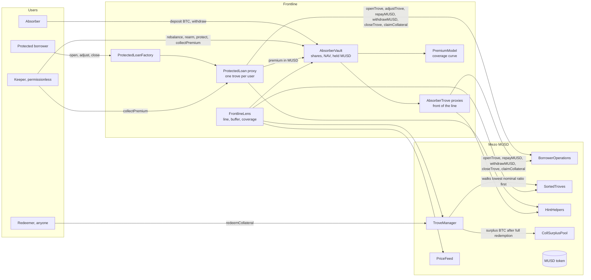
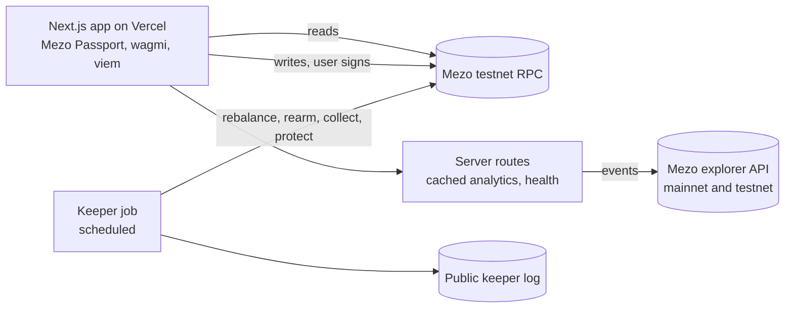

# Architecture: Frontline

## Contracts and Mezo dependencies

## Off-chain

## Adapter boundary (Phase 2 mocks, Phase 4 real)

All chain access goes through `web/lib/frontline/` with one typed interface and two implementations (`mock`, `chain`). Production builds fail if `mock` is selected.

## Key invariants (tested)

1. While absorber redeemable debt is above zero, no redemption reduces a protected loan's collateral.
2. A ProtectedLoan action never leaves its nominal ratio below the protection floor.
3. Vault NAV (BTC collateral × price + held MUSD + idle BTC − debt) is unchanged by a redemption at the oracle price, apart from fees.
4. Only the owner moves a protected loan's collateral or principal; the keeper can only collect the premium due.
5. Share accounting: deposits and withdrawals cannot dilute existing absorbers (first-depositor and rounding attacks covered).
